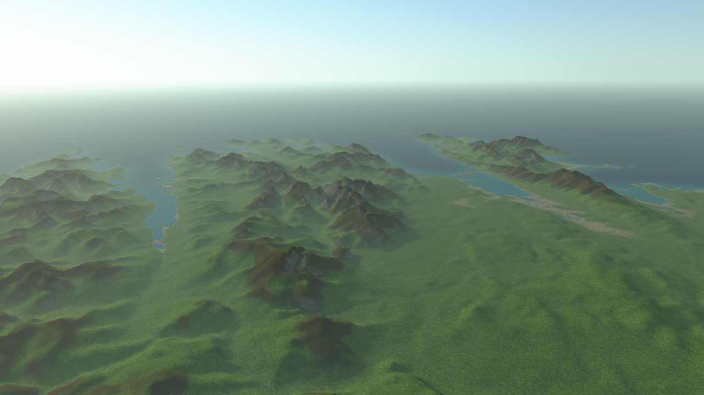
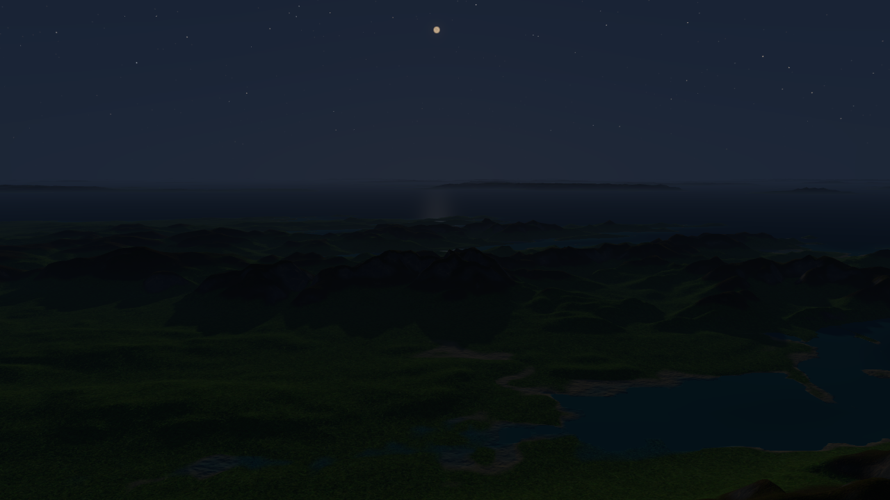
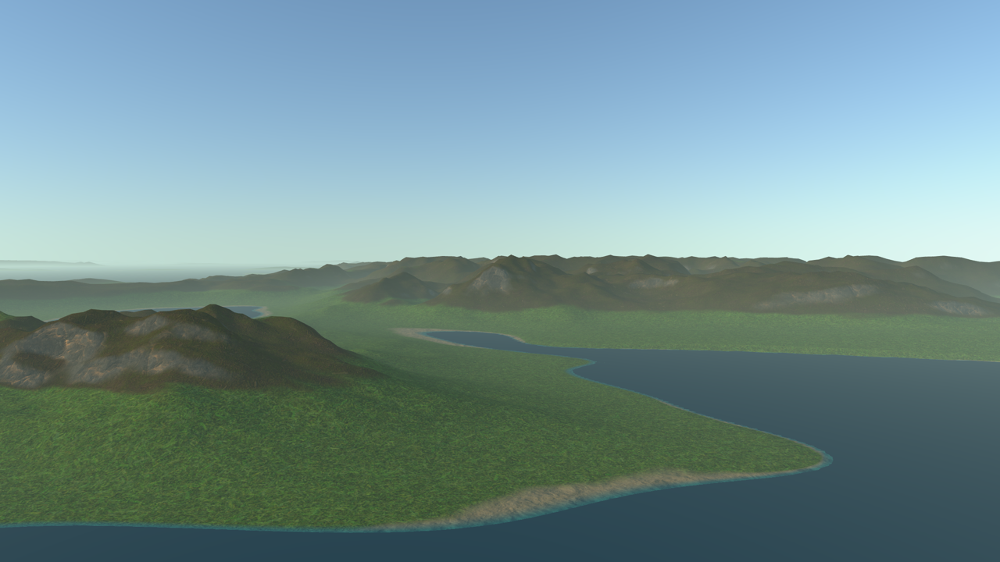
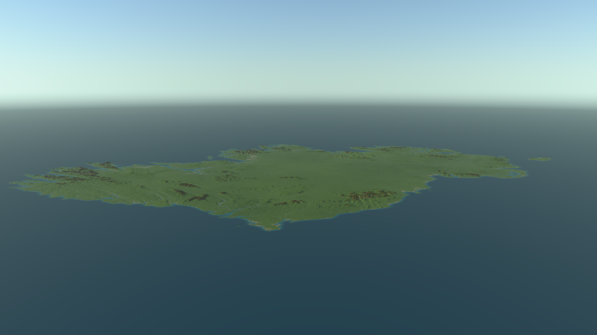
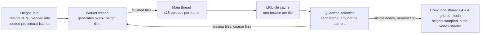

# Emerald Isle

[](https://github.com/leahweldon/emerald-isle/actions/workflows/build.yml)

A real-time terrain renderer of Ireland, written in C++17 and modern shader-based OpenGL.

> **Work in progress.** This is a ground-up rebuild of my Year 4 Computer Graphics final project at Trinity College Dublin, *Toward a Futuristic Emerald Isle*. The original used legacy fixed-function OpenGL; this version is built on a programmable pipeline, runs on macOS, Windows and Linux, and implements the features the original only approximated.



## Roadmap

- [x] **1. Foundations:** cross-platform build, OpenGL 3.3 core context, shader loading, FPS display, CI
- [x] **2. Terrain:** mesh generated from an Ireland heightmap, with per-vertex normals and directional lighting
- [x] **3. Surface materials:** grass, rock and sand blended by height and slope
- [x] **4. Sky and camera:** cubemap sky and a free-fly camera
- [x] **5. Infinite world:** terrain chunks streamed around the camera, with level of detail
- [x] **6. Shadows:** cascaded shadow maps and horizon-map distant shadows from a moving sun, with a day/night cycle
- [ ] **7. Water:** planar reflections and animated waves
- [ ] **8. Weather:** GPU-instanced rain
- [ ] **9. Tools:** in-app panel for toggling features and viewing frame timings
- [ ] **10. Web:** WebGL build with a live demo

## Screenshots

The milestone 6 images are reproducible with `--view <name> --screenshot <file>` plus the options shown. Earlier images show the renderer as it was at that milestone; lighting has changed since, so they no longer reproduce exactly.









## How the infinite world works



- **Height:** inside Ireland's rectangle the world is the Copernicus DEM. Outside it, domain-warped fractal noise is shaped into islands with a falloff to sea level. The two are cross-faded near the DEM border, with a ring of open sea around Ireland so there is no seam. The same `--seed` always gives the same world.
- **Level of detail (CDLOD):** the world is a quadtree of square nodes from 4 km to 524 km across, with roots tiled around the camera. A node splits into four when the camera is within 2.5× the child size, so every node covers a similar part of the screen. Grid vertices morph onto the next coarser grid as they approach a node's range, so levels meet without popping or cracks; skirts cover any gap while a level is still loading. Nodes outside the view frustum are skipped.
- **Streaming:** missing tiles are generated on a background thread, coarsest first, and uploaded a few per frame. A node is drawn with its parent's coarser tile until its own detail arrives, so a frame never waits for the worker.
- **Precision:** the camera position is double precision and everything is rendered relative to it (a floating origin). Material textures and noise repeat every 360 km, so their coordinates are wrapped per node. Thousands of kilometres out, there is no jitter.

## How light and shadow work

- **Sun and moon:** the sun's position comes from the NOAA solar equations for a local clock time and date at 53.4° N, 8° W, with Irish summer time and refraction, so sunrise directions, sunset times and the noon height are right (60° at midsummer, 13° at midwinter). Its colour and strength come from the same Rayleigh, Mie and ozone model as the sky, so a low sun is warm and dim. The moon is always full, opposite the sun, and takes over as the light once the sun has set; stars turn about the celestial pole and fade in with the dark, and the sky keeps a dark blue floor of airglow, so night is never black.
- **Sky:** the sky is rendered into a cubemap, which also gives the ambient light (spherical harmonics) and the fog colour. While the sun moves, a second cubemap is rendered one face per frame and its small mip is read back asynchronously for the ambient light, then both are swapped in together, so the sky never causes a frame spike.
- **Cascaded shadow maps:** four 2048² cascades cover the view from about half the camera's height above the ground out to ten times that height (30–150 km). Each cascade is fitted to the bounding sphere of its slice of the view and snapped to whole texels in world space, so shadows do not shimmer as the camera moves or turns. The depth pass reuses the CDLOD node selection, culled to each cascade and coarser in the outer ones, and clamps casters between a cascade and the sun onto its near plane. Receivers use a 3 × 3 hardware-filtered PCF, a normal offset that grows as the light grazes the surface, and a slope-scaled depth bias, and neighbouring cascades are cross-faded. Shadows dim only direct light, so the sky still lights the shade; they fall on the sea too.
- **Distant shadows:** beyond the last cascade, each terrain tile (4 km nodes and coarser) carries a horizon map, made on the worker thread when the tile is generated: for every other grid point, the elevation of the horizon in eight compass directions, found by marching outwards over the tile and over a coarser grid of heights reaching two node widths beyond it. The shader interpolates the horizon angle at the light's bearing and compares it with the light's elevation, and the last cascade fades into it. This costs two texture fetches per pixel, about 2 ms more work per coarse tile on the worker and nothing measurable on the GPU; ray-marching the height texture towards the sun would need a dozen or more fetches per pixel every frame and could not see casters past the edge of the node's own tile. The sea gets cascade shadows only; beyond them the haze dominates.

## Building

Requirements: a C++17 compiler, CMake 3.20+ and Git. All libraries are downloaded automatically when you configure.

```bash
git clone https://github.com/leahweldon/emerald-isle.git
cd emerald-isle
cmake -S . -B build -DCMAKE_BUILD_TYPE=Release
cmake --build build --config Release
```

On Linux, install the X11 and OpenGL headers first:

```bash
sudo apt-get install libxrandr-dev libxinerama-dev libxcursor-dev libxi-dev libgl-dev
```

## Running

```bash
./build/emerald-isle                 # macOS / Linux
build\Release\emerald-isle.exe       # Windows (Visual Studio generator)
```

| Option | Description |
|---|---|
| `--width <px>`, `--height <px>` | Window size (default 1280 × 720) |
| `--no-vsync` | Render as fast as possible, to measure frame rate |
| `--headless` | Keep the window hidden and never take focus; render into an offscreen framebuffer at exactly `--width` × `--height` (no HiDPI scaling, 4× MSAA resolved). Needs `--frames`, `--screenshot` or `--autofly`. Vsync is off, and the frame log's focus column is always 0 |
| `--frames <n>` | Exit after rendering *n* frames |
| `--screenshot <file>` | Save the final frame as a PNG, then exit |
| `--view <name>` | Start in free-fly at a preset pose instead of the orbit: `overview`, `kerry`, `wicklow`, `glenbeigh`, `archipelago`, `ridges`, `kerry-south` |
| `--time <HH:MM>` | Local clock time in Irish civil time, summer time included (default 18:00). The sun's position comes from the solar equations for 53.4° N, 8° W |
| `--date <MM-DD>` | Date (default 06-21, midsummer) |
| `--sun-bearing <deg>`, `--sun-elevation <deg>` | Fix the sun at a compass bearing (0 = north, default 225) and elevation (default 22) instead of following the time of day |
| `--seed <n>` | Procedural world seed (default 1); the same seed always gives the same islands |
| `--autofly <s>` | Fly straight ahead at 2.5 km/s for *s* seconds, print frame and streaming stats, exit |
| `--frame-log <file>` | Write a CSV row per frame: time in events, update, terrain streaming, rendering and swap, tile and triangle counts, and whether the window had focus |
| `--validate <tiles>` | Check correctness during the run: no GL errors (counted separately inside the shadow passes), shadow casters drawn, no holes in the visible terrain once it has loaded, ground always loaded under the camera, and at least *tiles* tiles generated and resident. Prints PASS/FAIL per check and exits non-zero on failure (used by CI) |
| `--gpu-timing` | Also measure GPU time per frame with timer queries (exit stats and `gpu_ms` in the frame log); costs ~0.4 ms a frame on macOS |

The window title shows the frame rate and frame time, terrain triangles, draw calls and loaded tiles (plus any still streaming). On exit the app prints the median, p99 and maximum frame time, the frames over the 120 Hz and 60 Hz budgets (8.3 ms and 16.7 ms), the time before the swap (CPU work plus driver waits, so the rest of a slow frame is waiting to present), and the terrain's main-thread cost. With vsync on, the frame rate follows the display's refresh rate (logged at startup) and the exit stats add the average presentation rate. Single frame times are less useful then: a swap sometimes returns at once and the next waits two refreshes, so pairs of ~1.7 ms and ~15 ms frames appear even when every refresh gets a new frame.

On a MacBook's ProMotion display, GLFW with OpenGL presents at 120 Hz (measured 120.1 frames per second on an M5 over one-minute flights). macOS drops it towards 60 Hz in Low Power Mode and when the window is in the background, and in those states swaps and event polling can also stall for 50-200 ms; profile on mains power with the window in front. Headless runs present nothing, so their frame times are not comparable with a visible window; use them for screenshots and `--validate`, not for profiling.

### Controls

| Action | Trackpad | Mouse |
|---|---|---|
| Fly forward / back | **W** / **S** | **W** / **S** |
| Strafe left / right | **A** / **D** | **A** / **D** |
| Down / up | **Q** / **E** | **Q** / **E** |
| Look around | Two-finger scroll (drags the view) | Hold the right button and drag; the wheel tilts |
| Free look | **Tab** captures the cursor, then move a finger; **Tab** again to release | **Tab**, then move the mouse |
| Turn / pitch | **←** **→** / **↑** **↓** | **←** **→** / **↑** **↓** |
| Faster | Hold **Shift** (5×) | Hold **Shift** (5×) |
| Speed multiplier | **[** / **]** or **-** / **=** (×1.25 per press) | **[** / **]** or **-** / **=** |
| Free-fly ↔ orbit | **C** | **C** |
| Pause / resume time | **T** | **T** |
| Time back / forward 15 min | **,** / **.** (1 hour with **Shift**) | **,** / **.** (1 hour with **Shift**) |
| Print pose as a `--view` preset line | **P** | **P** |
| Quit | **Esc** | **Esc** |

Flying speed follows your height above the ground, like a map viewer: about 50 m/s skimming the hills at 30 m, about 2.4 km/s at a 1.5 km cruising height (Kerry to the edge of the DEM in about 12 s), and faster still from orbit. The multiplier keys scale that, and the window title shows the current speed (or "orbit"). Without `--view` the app starts in a slow orbit of the island; press **C** to take control. The camera stays at least 30 m above the ground and sea.

Time runs at one minute per second in interactive sessions, and the window title shows the clock and date. Runs that end by themselves (`--frames`, `--screenshot`, `--autofly`) keep the time fixed so they are reproducible.

## Project structure

```text
src/
  core/     window and context, frame timing, application loop, screenshots
  render/   shaders, atmosphere and sky, shadow maps, camera and view presets, CDLOD terrain, materials, sea
  world/    height field (DEM + procedural islands), noise, solar position, tile streaming and horizon maps
assets/
  shaders/  GLSL source
  textures/ Ireland heightmap (16-bit, built by tools/make_heightmap.py)
    materials/  CC0 colour and normal maps from ambientCG
tools/      data preparation scripts
external/
  glad/     OpenGL 3.3 core loader (generated with glad2)
```

## Data

The terrain is built from Copernicus DEM GLO-90, reprojected to Irish Transverse Mercator. See [tools/README.md](tools/README.md) to regenerate it.

Contains modified Copernicus DEM data, © DLR e.V. 2010–2014 and © Airbus Defence and Space GmbH 2014–2018, provided under COPERNICUS by the European Union and ESA.

## Built with

[GLFW](https://www.glfw.org/) · [glad](https://github.com/Dav1dde/glad) · [GLM](https://github.com/g-truc/glm) · [stb](https://github.com/nothings/stb)

## Credits

Terrain textures are CC0 from [ambientCG](https://ambientcg.com/); elevation data is from Copernicus DEM. Every asset, with its source URL and licence, is listed in [CREDITS.md](CREDITS.md).
