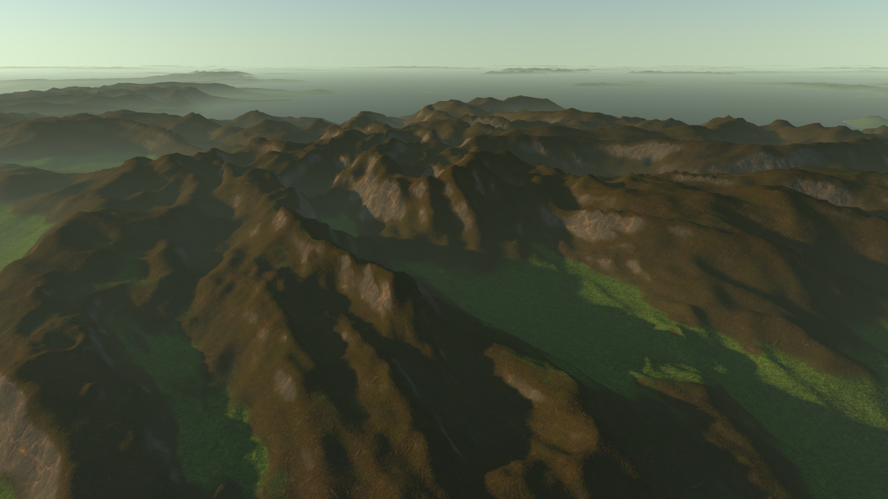
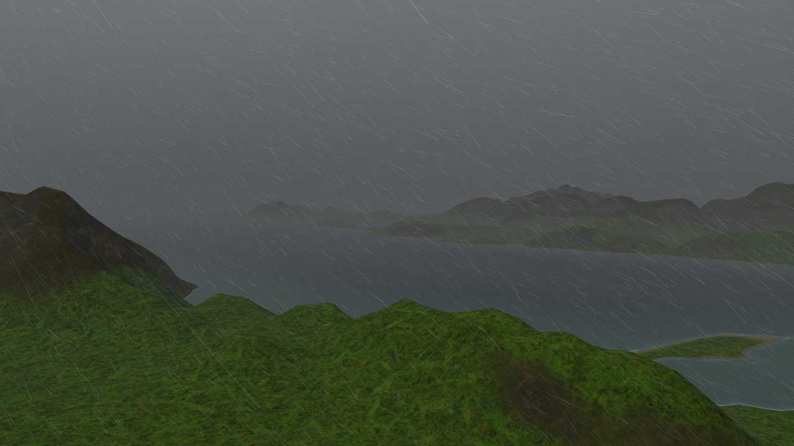
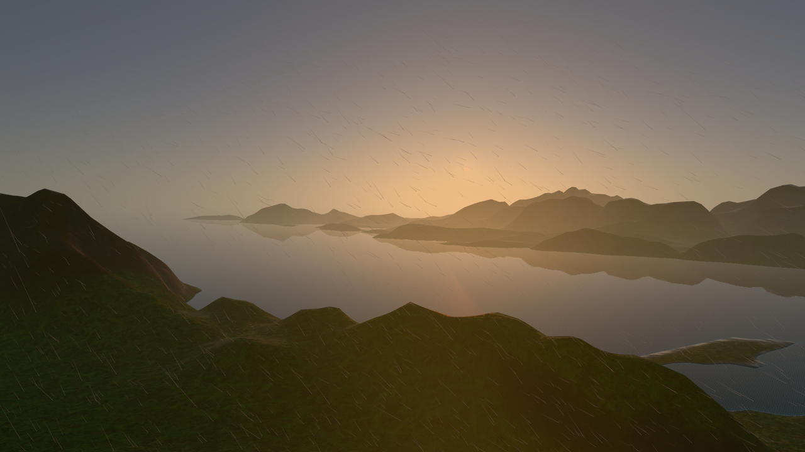
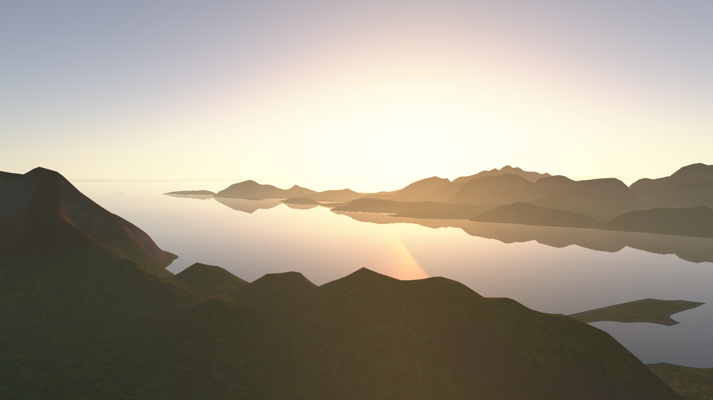
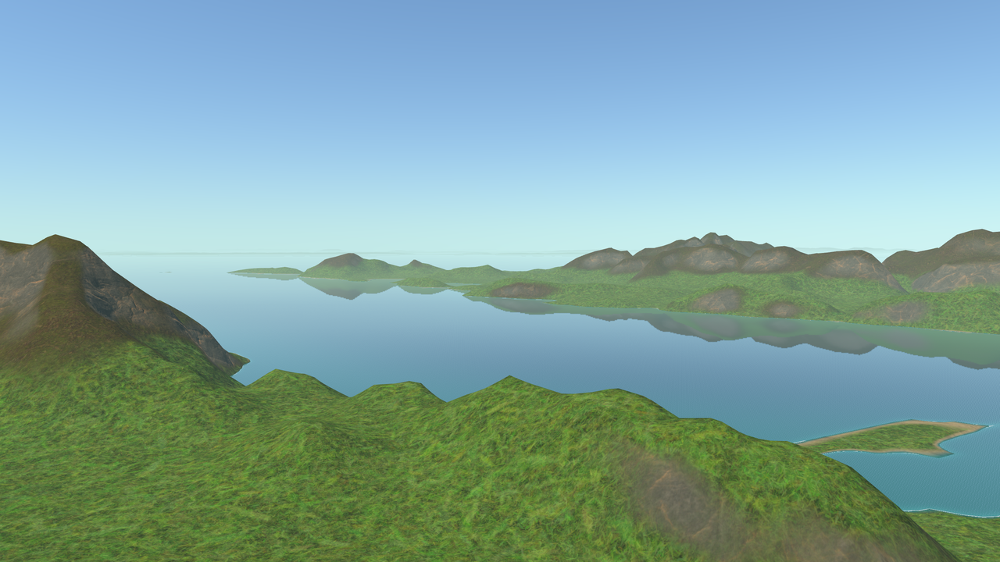
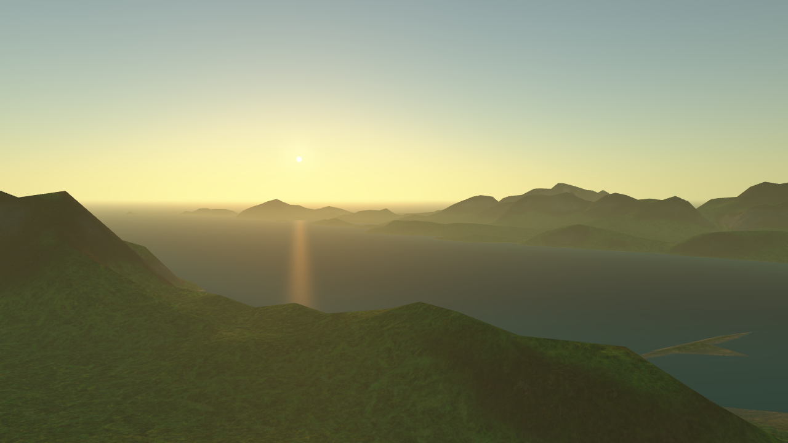
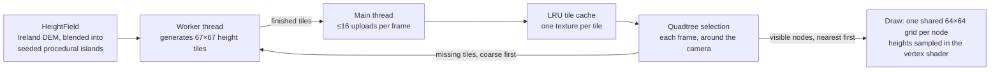
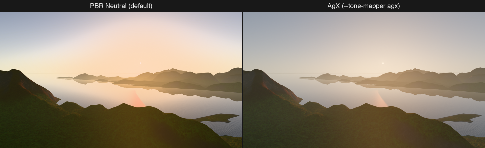
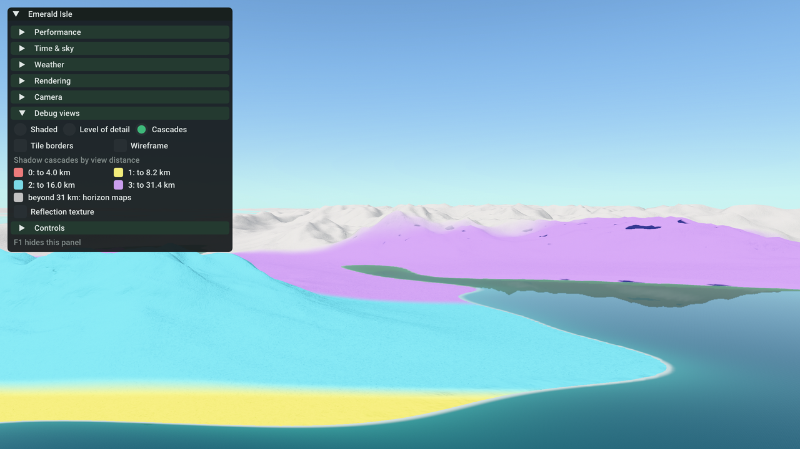

# Emerald Isle

[](https://github.com/leahweldon/emerald-isle/actions/workflows/build.yml)
[](https://github.com/leahweldon/emerald-isle/actions/workflows/web.yml)
[](https://leahweldon.github.io/emerald-isle/)

**[Live demo](https://leahweldon.github.io/emerald-isle/)**: the renderer in your browser (WebGL 2; about 7 MB to download).

A real-time terrain renderer of Ireland, written in C++17 and modern shader-based OpenGL.

> **Work in progress.** This is a ground-up rebuild of my Year 4 Computer Graphics final project at Trinity College Dublin, *Toward a Futuristic Emerald Isle*. The original used legacy fixed-function OpenGL; this version is built on a programmable pipeline, runs on macOS, Windows and Linux, and implements the features the original only approximated.



## Roadmap

- [x] **1. Foundations:** cross-platform build, OpenGL 3.3 core context, shader loading, FPS display, CI
- [x] **2. Terrain:** mesh generated from an Ireland heightmap, with per-vertex normals and directional lighting
- [x] **3. Surface materials:** grass, rock and sand blended by height and slope
- [x] **4. Sky and camera:** cubemap sky and a free-fly camera
- [x] **5. Infinite world:** terrain chunks streamed around the camera, with level of detail
- [x] **6. Shadows:** cascaded shadow maps and horizon-map distant shadows from a moving sun, with a day/night cycle
- [x] **7. Water:** Gerstner waves, drifting ripples, planar reflections, depth-tinted shallows, foam and a sun and moon glint
- [x] **8. Weather:** GPU rain simulated with transform feedback and drawn as instanced streaks, with splashes, overcast skies, wet ground and raindrop rings on the sea
- [x] **9. Tools:** in-app panel (Dear ImGui) with live stats and GPU time per pass, controls for time, weather, rendering and camera, and debug views of the level of detail and shadow cascades
- [x] **10. Web:** WebGL 2 build from the same source, deployed to GitHub Pages as a [live demo](https://leahweldon.github.io/emerald-isle/)

## Screenshots

The image at the top is milestone 6 at golden hour. Milestone 6 to 9 images are reproducible with `--view <name> --screenshot <file>` plus the options shown (rendered at 2560 × 1440 and downscaled; screenshots freeze the waves and step the rain at a fixed rate; panel readings vary from run to run).









 Earlier images show the renderer as it was at that milestone; lighting has changed since, so they no longer reproduce exactly.





## How the infinite world works



- **Height:** inside Ireland's rectangle the world is the Copernicus DEM. Outside it, domain-warped fractal noise is shaped into islands with a falloff to sea level. The two are cross-faded near the DEM border, with a ring of open sea around Ireland so there is no seam. The same `--seed` always gives the same world.
- **Level of detail (CDLOD):** the world is a quadtree of square nodes from 4 km to 524 km across, with roots tiled around the camera. A node splits into four when the camera is within 2.5× the child size, so every node covers a similar part of the screen. Grid vertices morph onto the next coarser grid as they approach a node's range, so levels meet without popping or cracks; skirts cover any gap while a level is still loading. Nodes outside the view frustum are skipped.

  
- **Streaming:** missing tiles are generated on a background thread, coarsest first, and uploaded a few per frame. A node is drawn with its parent's coarser tile until its own detail arrives, so a frame never waits for the worker.
- **Precision:** the camera position is double precision and everything is rendered relative to it (a floating origin). Material textures and noise repeat every 360 km, so their coordinates are wrapped per node. Thousands of kilometres out, there is no jitter.

## How the water works

- **Surface:** the sea is a grid of rings centred on the camera, their radii growing by about 3% from 1 m out to the far plane, so cells stay roughly square at every distance and there is no edge. Four Gerstner waves, set by a wind constant (8 m/s towards the east-north-east) and travelling at their deep-water speeds, displace it in the vertex shader; each fades out within a few wavelengths of the camera, before the rings are too coarse to carry it. Their wave vectors lie on a 1,536 m lattice, so world positions are wrapped in double precision and stay exact anywhere.
- **Ripples:** two tileable normal maps, generated from a wave spectrum by `tools/make_water_normals.py`, drift with the wind in different directions at 64 m and 16 m scales. Far away their mipmaps average out; the lost slope (Toksvig) and the slope of waves too small to resolve (Cox and Munk, from the wind speed) become roughness, so the glint spreads into a glitter path.
- **Reflection:** Schlick Fresnel blends the water colour (looking down) with reflections (at grazing angles), so the far sea runs into the sky at the horizon. The terrain is drawn mirrored about sea level into a half-resolution HDR texture, with coarser levels of detail and plain material colours; the sea reads it at its own screen position, nudged by the ripples, over the sky cubemap where nothing was drawn.
- **Depth:** the ground under the sea around the camera is rendered straight down into two depth layers (near and wide), each snapped to its texel grid, giving the water depth at every point. Shallow water is clear turquoise fading to blue-green offshore, with lacy foam where it is under a metre deep; around Ireland, whose sea floor in the DEM is flat, a blurred coast mask still tints kilometres of coastal water.
- **Light:** the sun or moon glint is GGX specular, dimmed by the cascaded shadows, so headlands shade bays and golden hour and moonlit nights get a glitter path. Fog, night vision and the coastal blend into the terrain apply as before.

## How the rain works

- **Simulation (transform feedback):** up to 196,608 raindrops live in a vertex buffer, each with a position, velocity and diameter (0.5–5 mm, mostly small). Every frame a vertex shader advances them, one drop per vertex, with rasterisation off, and transform feedback writes the results into a second buffer; the two buffers swap roles each frame (ping-pong). Each drop falls under gravity against quadratic air drag, scaled so it settles at its terminal velocity (about 2 m/s for the smallest drops, 9 m/s for the largest), and drifts with the same wind that drives the waves. Steps are delta-time based, capped at 50 ms.
- **The box:** drops fill an 80 m box from 60 m below the camera to 20 m above it. Positions are stored world-fixed modulo the box size, so the box wraps around the camera: a drop leaving one side comes back on the other, the density stays constant at any flying speed, and coordinates stay small however far out the camera is.
- **Collision:** the terrain under the box is rendered straight down into a 128 × 128 height map from the streamed tiles each frame (skipped when the camera is too high for drops to reach the ground). A drop that crosses the ground or the sea during a step respawns at the top of the box. A landing on the ground also records its position, and a second pool of 32,768 splash droplets, advanced the same way, reads those landings through a buffer texture: each dead droplet checks its share of the drops and, on a landing, jumps outwards and upwards, falls, bounces once and fades within half a second.
- **Drawing (instancing):** drops and droplets are drawn after the opaque scene and before tone mapping, as instanced camera-facing quads: one instance per particle, four vertices built in the vertex shader. Each is a streak from the particle back along its velocity relative to the camera over 50 ms, so the rain slants with the wind and stretches when flying. Streaks are depth tested against the scene without writing depth. Depth clamping keeps drops nearer than the near plane (often hundreds of metres from a high camera) in front of everything instead of clipping them. A streak is at least a fixed angle wide (a pixel at 720p) with its opacity scaled by its true width, so distant drops fade instead of aliasing; each particle counts for many real drops. Streaks add light to the scene and never darken it: each drop passes on some of the sky light around it, plus the bright light behind it (the sky above the line of sight, and the sun or moon when it is behind the drop and not hidden by cloud), so rain glows against a low sun and shows at noon, golden hour and night. Each drop has its own width, opacity and streak length; near drops are drawn a little wider and softer, far ones thinner and fainter.
- **Weather:** rain intensity runs from 0 (dry) to 1 (heavy) and eases towards its target over a few seconds. It clouds the sky over (full cover from moderate rain), with a grey overcast that follows the sun's height, so the ambient light and fog colour follow too. It dims direct light by up to 85% and weakens shadows, hides the sun, moon, stars and the sea's glint, and thickens the fog up to eightfold. The ground gets wet over a couple of seconds and dries more slowly: albedo darkens per material, and a water film, glossier on flat ground, reflects the sky. On the sea, procedural raindrop rings expand and fade near the camera. Rain roughens all the water out to the horizon: mirrored hills are smeared and lose contrast (softened in light rain, broken up in heavy rain), and shallow water loses its turquoise to grey-green under cloud.
- **Cost:** on an M5 with a 2560 × 1440 window, heavy rain (all 196,608 drops) adds about 0.8–1.35 ms of GPU time over 30 s flights, and light rain about 0.5–0.6 ms. Shading is cheap. Nearly all of the cost is per instance: even drops rejected in the vertex shader cost vertex work, and only about 7% of the box is in view. That is what caps the drop count. Compacting visible drops on the GPU would need geometry shaders or GL 4 features, beyond the OpenGL 3.3 baseline.

## How light and shadow work

- **Sun and moon:** the sun's position comes from the NOAA solar equations for a local clock time and date at 53.4° N, 8° W, with Irish summer time and refraction, so sunrise directions, sunset times and the noon height are right (60° at midsummer, 13° at midwinter). Its colour and strength come from the same Rayleigh, Mie and ozone model as the sky, so a low sun is warm and dim. As the sun drops below 30°, the air takes on an evening haze (denser, reddening aerosol) that gives a warm glow towards the sun, and the low sun's light is saturated and lifted while the sky light in shade is cooled, so golden hour has warm slopes against blue shade; noon is unaffected. The moon is always full, opposite the sun, and takes over as the light once the sun has set; stars turn about the celestial pole and fade in with the dark, and the sky keeps a dark blue floor of airglow, so night is never black. At night, colours fade and shift towards blue as the eye's rods take over (the Purkinje effect), so moonlit land reads blue-grey.
- **HDR and tone mapping:** the scene is rendered unclamped into a multisampled floating-point target (packed R11G11B10F: the same image as RGBA16F at a quarter of the cost), resolved, and tone mapped in one final pass: exposure, then the Khronos PBR Neutral curve, then sRGB with a little dither against banding. PBR Neutral is linear up to about 0.8, like the earlier display transform, so noon views are close to before; above that it compresses highlights keeping their hue and fades them to white only gradually, so a low sun's glow is a smooth warm gradient instead of clipped white. `--tone-mapper agx` switches to AgX, a filmic curve that turns bright colours towards white sooner. At night the exposure rises by up to one stop, as the eye adapts, so moonlit land stays readable. The whole pipeline costs about 0.1 ms of GPU time at 2560 × 1440.
  Why these choices: AgX and fitted ACES were tried first. Both stop the clipping, but they turn bright colours towards white early, so the noon sky came out 10–15% paler and the warm glow around a setting sun went grey-pink; PBR Neutral keeps both. The HDR target is R11G11B10F rather than RGBA16F because, with 4× MSAA at 2560 × 1440, RGBA16F's doubled bandwidth cost about 1 ms of GPU time against 0.1–0.3 ms, for an image at most 3/255 different and with no banding after the dither.

  
- **Sky:** the sky is rendered into a cubemap, which also gives the ambient light (spherical harmonics) and the fog colour. While the sun moves, a second cubemap is rendered one face per frame and its small mip is read back asynchronously for the ambient light, then both are swapped in together, so the sky never causes a frame spike.
- **Cascaded shadow maps:** four 2048² cascades cover the view from about half the camera's height above the ground out to ten times that height (30–150 km). Each cascade is fitted to the bounding sphere of its slice of the view and snapped to whole texels in world space, so shadows do not shimmer as the camera moves or turns. The depth pass reuses the CDLOD node selection, culled to each cascade and coarser in the outer ones, and clamps casters between a cascade and the sun onto its near plane. Receivers use a 3 × 3 hardware-filtered PCF, a normal offset that grows as the light grazes the surface, and a slope-scaled depth bias, and neighbouring cascades are cross-faded. Shadows dim only direct light, so the sky still lights the shade; they fall on the sea too.

  
- **Distant shadows:** beyond the last cascade, each terrain tile (4 km nodes and coarser) carries a horizon map, made on the worker thread when the tile is generated: for every other grid point, the elevation of the horizon in eight compass directions, found by marching outwards over the tile and over a coarser grid of heights reaching two node widths beyond it. The shader interpolates the horizon angle at the light's bearing and compares it with the light's elevation, and the last cascade fades into it. This costs two texture fetches per pixel, about 2 ms more work per coarse tile on the worker and nothing measurable on the GPU; ray-marching the height texture towards the sun would need a dozen or more fetches per pixel every frame and could not see casters past the edge of the node's own tile. The sea gets cascade shadows on its light and glint only; beyond them the haze dominates.

## The panel

**H** (or **`** or **F1**) opens an in-app panel, built on [Dear ImGui](https://github.com/ocornut/imgui) and drawn after tone mapping, so it is not tone mapped. It is open from the start in interactive sessions and closed in runs that end by themselves, unless `--ui` is passed. Its sections:

- **Performance:** frame rate, a frame-time graph of the last 480 frames, GPU time per pass from timer queries, and terrain stats: triangles and draw calls (also for the shadow and reflection passes), resident and generated tiles, and the streaming queue. Timer queries run only while the panel is open. They are placed between render passes. Inside the main HDR pass they would split it, which costs extra on macOS, so terrain, sea, sky and rain drops are timed together as "Scene" unless **Split the scene pass** is ticked.
- **Time & sky:** clock, date, time speed and pause, and the sun's elevation and bearing.
- **Weather:** rain intensity, with dry, light and heavy buttons.
- **Rendering:** tone mapper and exposure, and switches for shadows, horizon shadows, reflections, fog and rain particles.
- **Camera:** view presets, speed, position, height and heading, and a button that copies the current pose as a `ViewPresets.cpp` line.
- **Debug views:** terrain coloured by level of detail or by shadow cascade (with legends of node sizes and cascade distances), node outlines, wireframe, and a preview of the reflection texture.
- **Controls:** the keyboard and trackpad controls.

**Cost** (M5, 1280 × 720 window at 2560 × 1440, 30 s flights): closed, nothing measurable, with GPU time within 0.01 ms of the build without the panel. Open, building the panel takes about 0.03 ms of CPU time. Frame times stay within run-to-run noise: unchanged over Kerry, where frames are held near 8.3 ms by the 120 Hz display, and about 0.3 ms longer on average over Glenbeigh. With the panel open, the timer queries make the CPU wait for the GPU inside the frame rather than at the swap, so the time before the swap reads about 5 ms higher without the frame taking longer.

While the pointer is over the panel or a widget is in use, the camera and shortcuts do not see the mouse or keys. Text is rasterised at full pixel resolution, so it stays sharp on HiDPI screens; headless captures scale the panel to the image as a 1280 × 720 window would show it.

## Web build

The [live demo](https://leahweldon.github.io/emerald-isle/) is the same C++ source compiled with Emscripten to WebAssembly and WebGL 2 (OpenGL ES 3.0), using Emscripten's contrib GLFW port (HiDPI canvas, resizing, pointer lock) and the same Dear ImGui panel. CI builds and smoke-tests it on every push and pull request (headless Chromium, failing on any console or WebGL error) and deploys it to GitHub Pages from `main`.

- **One source:** platform differences are confined to `src/platform/Gl` (GL header, capabilities probed at startup, and wrappers for the calls that differ), the window setup and the main loop, which the browser drives one frame at a time. Shaders are shared too: the `#version 330 core` line is replaced with `#version 300 es`, default precisions and defines for whatever the browser lacks. The desktop build renders exactly as before.
- **Threads:** pages can only use threads (SharedArrayBuffer) when served with cross-origin isolation headers, which GitHub Pages cannot send. A service worker shim (coi-serviceworker) can fake them, but it reloads the page on the first visit, and it breaks embedding and caching in ways that are hard to debug, so the web build is single-threaded instead. Terrain tiles are generated on the main thread in small steps (a row of heights, a horizon direction), within a few milliseconds a frame, so streaming never stalls a frame; it takes a little longer to fill in than on desktop.
- **WebGL 2 differences**, and what the web build does instead:

  | Missing in WebGL 2 | Instead |
  |---|---|
  | Depth clamping (shadow casters past a cascade, rain nearer than the near plane) | Depth clamped per vertex in the shaders |
  | Buffer textures (rain landings read by the splash pass) | The drops are copied GPU-side into a 2D texture, only when rain can reach the ground |
  | Border colours (lit outside a shadow cascade) | The shader treats samples outside a cascade as lit |
  | Linear filtering of depth textures (seabed and rain-ground height maps) | Nearest filtering |
  | Reading a texture back (`glGetTexImage`; the sky's ambient light) | The cubemap face is read through a framebuffer into a pixel buffer, which is read when its fence has passed |
  | Rendering to RGB16F (the sky cubemap) | RGBA16F |
  | Wireframe (`glPolygonMode`) | Not available |
  | Clip distances | Not needed: the reflection pass already discards below sea level |

  Some features depend on extensions, used when present: float render targets (`EXT_color_buffer_float`; without them the scene is drawn into 8-bit targets with tone mapping in the scene shaders), linear filtering of float textures (`OES_texture_float_linear`; without it terrain heights are stored as half floats), anisotropic filtering, and GPU timer queries for the panel (`EXT_disjoint_timer_query_webgl2`, usually only in Chrome). Add `?webgl-fallbacks` to the demo's address to try every fallback at once.
- **Quality:** a **Quality** setting in the panel (and `--quality`) trades detail for speed. The web build starts at Medium; the desktop build is High.

  | | Low | Medium (web) | High (desktop) |
  |---|---|---|---|
  | Pixel ratio cap | 1 | 1.5 | none |
  | Shadow cascades | 1024² | 1536² | 2048² |
  | Reflection | 1/4 size | 1/3 size | 1/2 size |
  | Rain drops | 25% | 50% | 100% |
  | Level of detail range | 1.75× | 2× | 2.5× |
  | MSAA | off | 2× | 4× |

- **Download:** about 7 MB in all: `index.wasm` 0.9 MB (0.4 MB compressed), `index.js` 0.15 MB, and `index.data` 6.5 MB of assets. The material textures are re-encoded for the web by `tools/make_web_assets.py` (15 MB down to 2.5 MB); the 16-bit heightmap (2.5 MB) is kept as it is.
- **Measured** on an M5 MacBook (120 Hz display, window at 2× pixel density, so Medium renders the scene at 1.5×), 2,400-frame runs:

  | Browser | First view (golden-hour orbit) | 20 s flight over Kerry | GPU time | Main-thread work per frame |
  |---|---|---|---|---|
  | Chrome 158 | 120 FPS | 120 FPS | 4.2 ms (Kerry 4.5 ms) | median 0.5 ms, max 6.6 ms |
  | Firefox 161 | 120 FPS | 120 FPS | not available | median 1 ms, max 10 ms |
  | Safari 26.6 | 60 FPS | 60 FPS | not available | median 2 ms, max 6 ms |

  Every run held the display's rate. Safari draws at most 60 frames a second by default (its "Prefer page rendering updates near 60 fps" setting), and only Chrome offers GPU timer queries. Firefox and Safari report time to the millisecond only. Tile generation never took more than 5 ms of a frame, even flying at 2.5 km/s.
- **Phones and tablets:** on a touch screen (a coarse main pointer, or touch without a mouse or trackpad), the page passes `--touch`: Low quality unless the address sets another, no pointer lock, and touch input instead of the keyboard. While orbiting, one finger drags the view around the target, a pinch moves closer or further and two fingers move the target; the automatic rotation stops at the first touch. In free flight, one finger looks around, a pinch moves forward or back and two fingers move sideways and up or down. Three large buttons replace the panel: **View** (eight views, each orbiting slowly), **Time** (golden hour, noon, night) and **Weather** (dry, light rain, heavy rain). The page blocks scrolling, zoom and pull-to-refresh over the scene and keeps clear of the notch and home indicator, in portrait and landscape.

  On an iPhone (iOS 18.7, Safari, Low quality, 1,800 frames of the first view), the demo held 60 FPS, Safari's limit, with no frame over 16.7 ms (app work per frame: median 5 ms, max 7 ms). It ran on the half-float terrain fallback, as iOS Safari lacks `OES_texture_float_linear`. Terrain fills in slowly there: single-threaded WebAssembly on a phone generates tiles much more slowly than on a Mac (29 tiles in 30 s, against more than 200 on desktop browsers), so distant land stays coarse for longer. On Low quality and touch screens, tiles skip their horizon maps (distant shadows come from the cascades only) and the nearest tiles in view are generated first (see [#17](https://github.com/leahweldon/emerald-isle/issues/17)). In portrait, the vertical field of view widens (up to 80°) towards a landscape screen's horizontal view, and the orbit tilts down so land fills the frame.

  Low quality has no MSAA, so FXAA smooths edges in the final tone-mapping pass instead (on whenever the scene has no MSAA; `--fxaa on|off`, or the FXAA switch in the desktop panel). On the iPhone it made no measurable difference: 60 FPS and the same frame times with it on or off.
- **Options in the address:** any option can be passed as a URL parameter, for example [`?view=shore&rain=1&time=13:30`](https://leahweldon.github.io/emerald-isle/?view=shore&rain=1&time=13:30). Without any, the demo opens on golden hour over Dingle Bay, orbiting slowly until you press a key, click or scroll.
- **Measuring mouse look (development):** `?lookstats=10`, served locally (`localhost` or the local network), records 10 s of pointer-locked mouse look from the first locked move and posts the results to the page's server at `/report`: frame intervals, time from each mouse event to the frame that applies it, events per frame, any movement the camera did not turn by, and the app's work per frame. On a MacBook trackpad, after the pointer-lock fix: no long frames, and event-to-frame times of 9 ms (median) in Chrome at 120 Hz and 15 ms in Safari at 60 Hz, with all movement turned in both.

## Building

Requirements: a C++17 compiler, CMake 3.20+ and Git. All libraries are downloaded automatically when you configure.

```bash
git clone https://github.com/leahweldon/emerald-isle.git
cd emerald-isle
cmake -S . -B build -DCMAKE_BUILD_TYPE=Release
cmake --build build --config Release
```

On Linux, install the X11 and OpenGL headers first:

```bash
sudo apt-get install libxrandr-dev libxinerama-dev libxcursor-dev libxi-dev libgl-dev
```

For the web build, install [Emscripten](https://emscripten.org/docs/getting_started/downloads.html) (3.1.74 is what CI uses) and Python with Pillow (`pip install pillow`, for preparing the assets), then:

```bash
emcmake cmake -S . -B build-web -DCMAKE_BUILD_TYPE=Release
cmake --build build-web
python3 -m http.server -d build-web 8000   # then open http://localhost:8000
```

`cmake -DEMERALD_THREADS=OFF` builds the desktop app with the web's single-threaded tile generation, for testing it natively. `web/test/smoke.mjs` is the headless browser test CI runs (`cd web && npm ci && npx playwright install chromium && node test/smoke.mjs ../build-web`).

## Running

```bash
./build/emerald-isle                 # macOS / Linux
build\Release\emerald-isle.exe       # Windows (Visual Studio generator)
```

| Option | Description |
|---|---|
| `--width <px>`, `--height <px>` | Window size (default 1280 × 720) |
| `--no-vsync` | Render as fast as possible, to measure frame rate |
| `--headless` | Keep the window hidden and never take focus; render into an offscreen framebuffer at exactly `--width` × `--height` (no HiDPI scaling, 4× MSAA resolved). Needs `--frames`, `--screenshot` or `--autofly`. Vsync is off, and the frame log's focus column is always 0 |
| `--frames <n>` | Exit after rendering *n* frames |
| `--screenshot <file>` | Save the final frame as a PNG, then exit |
| `--view <name>` | Start in free-fly at a preset pose instead of the orbit: `overview`, `kerry`, `wicklow`, `glenbeigh`, `archipelago`, `ridges`, `kerry-south`, `shore` (low on a beach, close enough for rain to land nearby) |
| `--time <HH:MM>` | Local clock time in Irish civil time, summer time included (default 18:00). The sun's position comes from the solar equations for 53.4° N, 8° W |
| `--date <MM-DD>` | Date (default 06-21, midsummer) |
| `--sun-bearing <deg>`, `--sun-elevation <deg>` | Fix the sun at a compass bearing (0 = north, default 225) and elevation (default 22) instead of following the time of day |
| `--seed <n>` | Procedural world seed (default 1); the same seed always gives the same islands |
| `--autofly <s>` | Fly straight ahead at 2.5 km/s for *s* seconds, print frame and streaming stats, exit |
| `--frame-log <file>` | Write a CSV row per frame: time in events, update, terrain streaming, rendering and swap, tile and triangle counts, and whether the window had focus |
| `--validate <tiles>` | Check correctness during the run: no GL errors (counted separately inside the shadow passes), shadow casters drawn, no holes in the visible terrain once it has loaded, ground always loaded under the camera, and at least *tiles* tiles generated and resident. Prints PASS/FAIL per check and exits non-zero on failure (used by CI) |
| `--exposure <ev>` | Exposure offset in stops for the final tone mapping (default 0) |
| `--tone-mapper <name>` | `neutral` (default, Khronos PBR Neutral) or `agx` |
| `--ui` | Show the panel from the start, also in runs that end by themselves (it is drawn into `--headless` captures) |
| `--quality <level>` | `low`, `medium` or `high` (default `high`; `medium` on the web); see [Web build](#web-build) |
| `--orbit` | With `--view`, orbit the view's target slowly until the first key press, click or scroll, then fly from there |
| `--paused` | Start with the time of day paused (**T** resumes it) |
| `--webgl-fallbacks` | Web build only: use every WebGL fallback even where the browser has the feature, to test them |
| `--debug <view>` | Start with a debug view: `lod` (level-of-detail colouring), `cascades` (shadow-cascade colouring), `tiles` (node outlines) or `wireframe`; repeatable. With `--ui`, the panel opens on its debug section |
| `--rain <0-1>` | Start with rain of this intensity, 0 dry to 1 heavy (default 0); with `--validate`, also checks that every simulation step wrote the whole drop pool |
| `--gpu-timing` | Also measure GPU time per frame with timer queries (exit stats and `gpu_ms` in the frame log); costs ~0.4 ms a frame on macOS |

The window title shows the frame rate and frame time, terrain triangles, draw calls and loaded tiles (plus any still streaming). On exit the app prints the median, p99 and maximum frame time, the frames over the 120 Hz and 60 Hz budgets (8.3 ms and 16.7 ms), the time before the swap (CPU work plus driver waits, so the rest of a slow frame is waiting to present), and the terrain's main-thread cost. With vsync on, the frame rate follows the display's refresh rate (logged at startup) and the exit stats add the average presentation rate. Single frame times are less useful then: a swap sometimes returns at once and the next waits two refreshes, so pairs of ~1.7 ms and ~15 ms frames appear even when every refresh gets a new frame.

On a MacBook's ProMotion display, GLFW with OpenGL presents at 120 Hz (measured 120.1 frames per second on an M5 over one-minute flights). macOS drops it towards 60 Hz in Low Power Mode and when the window is in the background, and in those states swaps and event polling can also stall for 50-200 ms; profile on mains power with the window in front. Headless runs present nothing, so their frame times are not comparable with a visible window; use them for screenshots and `--validate`, not for profiling.

### Controls

| Action | Trackpad | Mouse |
|---|---|---|
| Fly forward / back | **W** / **S** | **W** / **S** |
| Strafe left / right | **A** / **D** | **A** / **D** |
| Down / up | **Q** / **E** | **Q** / **E** |
| Look around | Two-finger scroll (drags the view) | Hold the right button and drag; the wheel tilts |
| Free look | **Tab** captures the cursor, then move a finger; **Tab** again to release | **Tab**, then move the mouse |
| Turn / pitch | **←** **→** / **↑** **↓** | **←** **→** / **↑** **↓** |
| Faster | Hold **Shift** (5×) | Hold **Shift** (5×) |
| Speed multiplier | **[** / **]** or **-** / **=** (×1.25 per press) | **[** / **]** or **-** / **=** |
| Free-fly ↔ orbit | **C** | **C** |
| Pause / resume time | **T** | **T** |
| Time back / forward 15 min | **,** / **.** (1 hour with **Shift**) | **,** / **.** (1 hour with **Shift**) |
| Rain on / off | **R** | **R** |
| Light ↔ heavy rain | **Shift**+**R** | **Shift**+**R** |
| Print pose as a `--view` preset line | **P** | **P** |
| Show / hide the panel | **H**, **`** or **F1** (not while typing into a panel field) | **H**, **`** or **F1** |
| Look around (web build) | Click the scene to capture the pointer, **Esc** to release it | Click, then move the mouse |
| Touch screens (web build) | One finger drags the view, pinch moves, two fingers pan; **View**, **Time** and **Weather** buttons | |
| Quit | **Esc** | **Esc** |

Flying speed follows your height above the ground, like a map viewer: about 50 m/s skimming the hills at 30 m, about 2.4 km/s at a 1.5 km cruising height (Kerry to the edge of the DEM in about 12 s), and faster still from orbit. The multiplier keys scale that, and the window title shows the current speed (or "orbit"). Without `--view` the app starts in a slow orbit of the island; press **C** to take control. The camera stays at least 30 m above the ground and sea.

Time runs at one minute per second in interactive sessions, and the window title shows the clock and date (and the rain, while it rains). **R** starts and stops rain at the current level: light (30%) unless `--rain` set another; **Shift**+**R** switches between light and heavy and starts it. Rain eases in and out over a few seconds, and the ground dries more slowly. Runs that end by themselves (`--frames`, `--screenshot`, `--autofly`) keep the time fixed so they are reproducible.

## Project structure

```text
src/
  core/     window and context, frame timing, application loop, screenshots
  render/   shaders, atmosphere and sky, shadow maps, camera and view presets, CDLOD terrain, materials, sea surface, reflections and seabed map, rain
  platform/ OpenGL and OpenGL ES (WebGL 2) differences: header, capabilities, wrappers
  ui/       Dear ImGui setup, styling and HiDPI scaling (the panel's sections are in core/Panel.cpp)
  world/    height field (DEM + procedural islands), noise, solar position, tile streaming and horizon maps
assets/
  shaders/  GLSL source
  textures/ Ireland heightmap (16-bit, built by tools/make_heightmap.py)
    materials/  CC0 colour and normal maps from ambientCG
    water/      ripple normal maps (built by tools/make_water_normals.py)
tools/      data preparation scripts
web/        the web page (shell.html) and the headless browser smoke test
external/
  glad/     OpenGL 3.3 core loader (generated with glad2)
```

## Data

The terrain is built from Copernicus DEM GLO-90, reprojected to Irish Transverse Mercator. See [tools/README.md](tools/README.md) to regenerate it.

Contains modified Copernicus DEM data, © DLR e.V. 2010–2014 and © Airbus Defence and Space GmbH 2014–2018, provided under COPERNICUS by the European Union and ESA.

## Built with

[GLFW](https://www.glfw.org/) · [glad](https://github.com/Dav1dde/glad) · [GLM](https://github.com/g-truc/glm) · [stb](https://github.com/nothings/stb) · [Dear ImGui](https://github.com/ocornut/imgui)

## Credits

Terrain textures are CC0 from [ambientCG](https://ambientcg.com/); elevation data is from Copernicus DEM; the panel's font is Roboto (Apache 2.0). Every asset, with its source URL and licence, is listed in [CREDITS.md](CREDITS.md).
