# Emerald Isle

A real-time renderer of Ireland and an endless sea of procedural islands, in C++17 and OpenGL 3.3, running natively and in the browser.

[](https://github.com/leahweldon/emerald-isle/actions/workflows/build.yml)
[](https://github.com/leahweldon/emerald-isle/actions/workflows/web.yml)
[](https://leahweldon.github.io/emerald-isle/)
[](LICENSE)


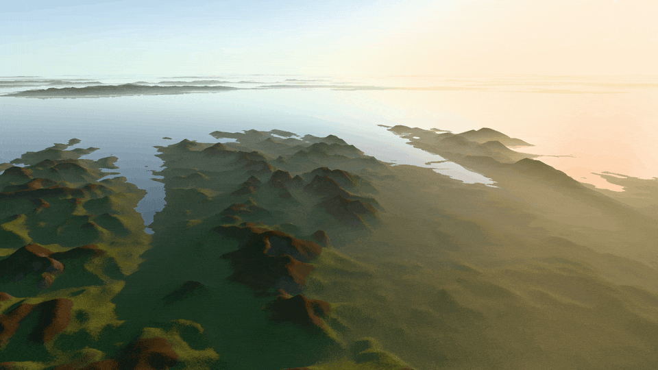

**[Open the live demo](https://leahweldon.github.io/emerald-isle/)**: WebGL 2, about 7 MB, on desktop browsers and phones.

## Features

| | |
|---|---|
| 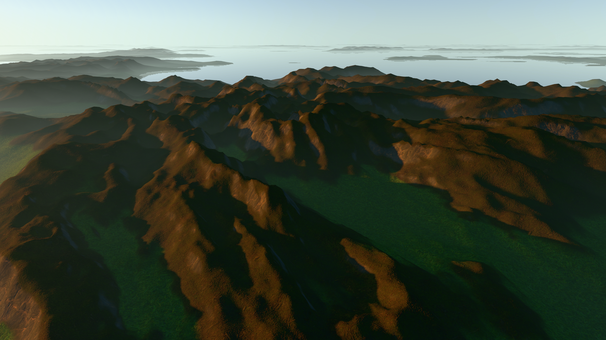 | **Ireland, then endless islands.** Inside Ireland the ground is the Copernicus 90 m elevation model; beyond it, domain-warped noise grows seeded archipelagos, cross-faded into the DEM behind a ring of open sea. The camera position is double precision and everything renders relative to it, so there is no jitter thousands of kilometres out. |
| 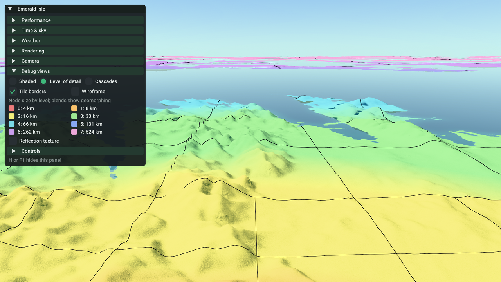 | **CDLOD terrain, streamed.** A quadtree of nodes from 4 km to 524 km, each drawn with one shared 64 × 64 grid displaced in the vertex shader. Nodes split within 2.5× their child's size and geomorph between levels, so there is no popping; tiles of 67 × 67 heights are generated on a worker thread, coarsest first, with up to 1,024 kept in an LRU cache. |
|  | **Shadows near and far.** Four 2048² cascades, texel-snapped so they never shimmer, cover 30–150 km. Beyond them each tile carries a horizon map (the horizon's elevation in 8 directions), so distant ridges shade valleys for two texture fetches per pixel. |
| 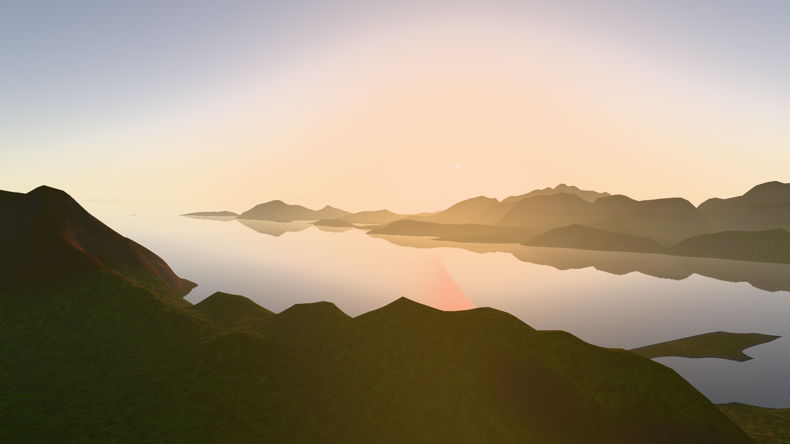 | **Water.** Four Gerstner waves on a camera-centred ring grid, two drifting ripple maps, and a planar reflection of the terrain at half resolution. Depth from a top-down seabed map tints the shallows turquoise and adds foam; the sun glint is GGX, shadowed by the cascades. |
|  | **GPU rain.** Up to 196,608 drops advanced by transform feedback (gravity, drag, wind) in an 80 m box that wraps around the camera, colliding with a height map of the ground below. Landings throw 32,768 splash droplets; both are drawn as instanced streaks. Heavy rain costs about 1 ms of GPU time. |
| 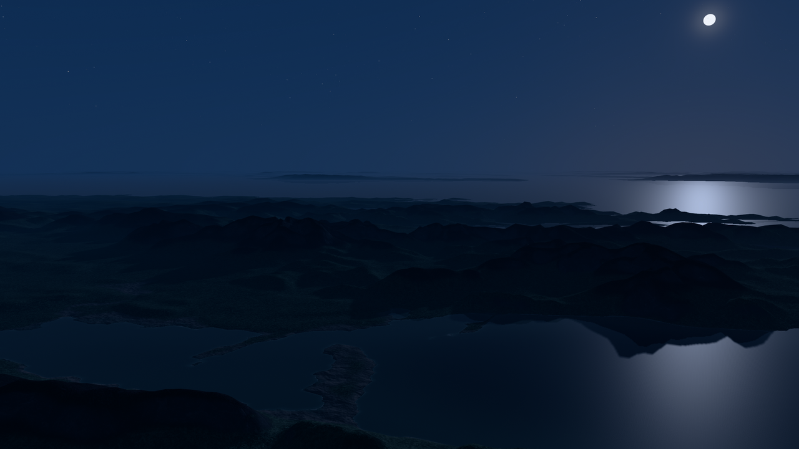 | **Sun, moon and sky.** NOAA solar equations for Irish time (60° at the midsummer noon, 13° in midwinter), a Rayleigh, Mie and ozone sky rendered into a cubemap that also lights the scene, a full moon, turning stars and a blue Purkinje shift at night. |
|  | **HDR.** The scene renders into a multisampled R11G11B10F target (RGBA16F's image at a quarter of the cost) and is resolved and tone mapped with Khronos PBR Neutral (or AgX, `--tone-mapper agx`) in one pass: 0.4 ms at 2560 × 1440. Low quality adds FXAA to that pass. |
| 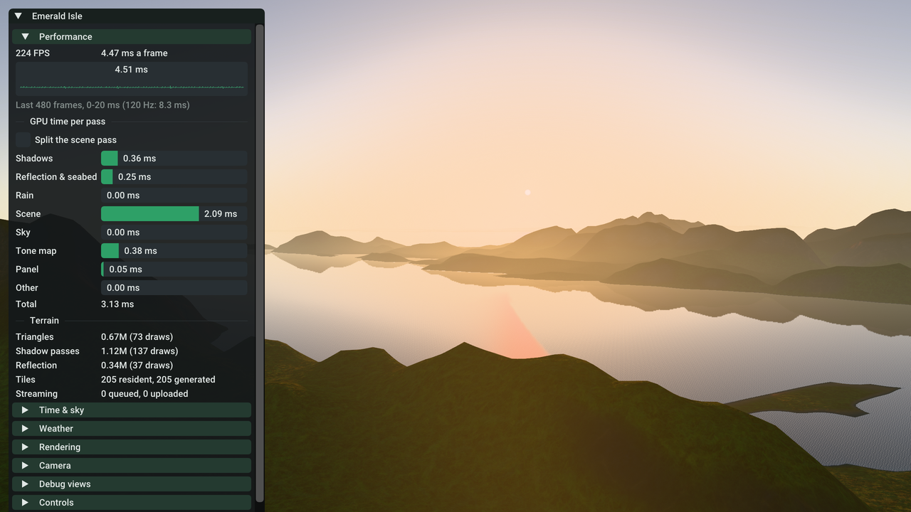 | **Panel.** Dear ImGui, drawn after tone mapping: frame-time graph, GPU time per pass, terrain stats, time and weather controls, feature switches and debug views. Closed, it costs nothing measurable. |
| 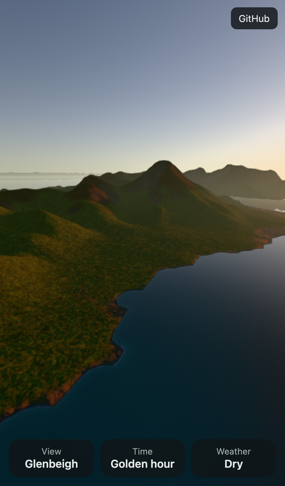 | **Web and phones.** The same source compiled with Emscripten to WebGL 2, single-threaded (tiles are generated in small steps within a few milliseconds a frame). Touch screens get gestures, three large buttons and Low quality, and hold 60 FPS on an iPhone. |

## Performance

| Platform | Quality | Rendered at | Frame rate | GPU time | Main-thread work per frame |
|---|---|---|---|---|---|
| Desktop app, M5 MacBook | High (4× MSAA) | 2560 × 1440 | 120 FPS (display) | 3.1 ms | — |
| Chrome 158, same Mac | Medium (2× MSAA) | 1.5× density | 120 FPS (display) | 4.2 ms | median 0.5 ms, max 6.6 ms |
| Firefox 161, same Mac | Medium | 1.5× density | 120 FPS (display) | not exposed | median 1 ms, max 10 ms |
| Safari 26.6, same Mac | Medium | 1.5× density | 60 FPS (Safari's cap) | not exposed | median 2 ms, max 6 ms |
| Safari, iPhone (iOS 18.7) | Low (FXAA) | 1× density, portrait | 60 FPS (Safari's cap) | not exposed | median 5 ms, max 7 ms |

Browsers: the demo's first view (golden hour over Dingle Bay) for 2,400 frames, 1,800 on the iPhone, on mains power; none dropped below the display's rate. Desktop: 120.1 FPS over one-minute flights, and the GPU time is the panel's reading in a headless 2560 × 1440 render of the first view (scene 2.1 ms, shadows 0.4 ms, reflection and seabed 0.25 ms, resolve and tone map 0.4 ms); heavy rain adds about 1 ms. Single-threaded tile generation is the phone's limit: 29 tiles in the first 30 s, against more than 200 in desktop browsers ([#17](https://github.com/leahweldon/emerald-isle/issues/17)).

## Architecture

One frame, in order:

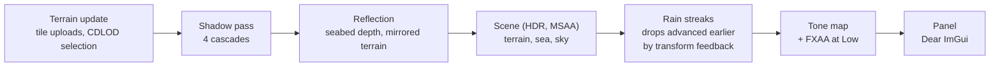

Tile streaming:

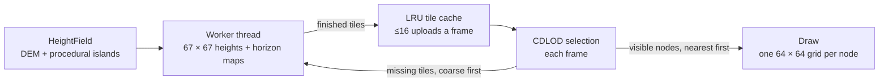

A node is drawn with its parent's tile until all four children arrive, so a frame never waits for the worker. On the web there is no worker: the same jobs run on the main thread in steps (a row of heights, a horizon direction) within a per-frame budget. Platform differences live in `src/platform/Gl`; shaders are shared, with `#version 300 es` and defines for what WebGL 2 lacks.

```text
src/core/     app loop, window, input, camera control, options, panel
src/render/   terrain, sea, sky, shadows, reflections, rain, tone mapping
src/world/    height field, noise, sun position, tile cache, CDLOD selection, tile streaming
src/platform/ OpenGL / WebGL 2 differences
tests/        unit tests (doctest)
web/          the page and its browser tests
tools/        data preparation and recording
```

## Build and run

Needs a C++17 compiler, CMake 3.20+ and Git; every library is fetched at configure time. On Linux, first `sudo apt-get install libxrandr-dev libxinerama-dev libxcursor-dev libxi-dev libgl-dev`.

```bash
git clone https://github.com/leahweldon/emerald-isle.git && cd emerald-isle
cmake -S . -B build -DCMAKE_BUILD_TYPE=Release
cmake --build build --config Release
./build/emerald-isle                      # Windows: build\Release\emerald-isle.exe
```

Web, with [Emscripten](https://emscripten.org/docs/getting_started/downloads.html) 3.1.74 and Python with Pillow:

```bash
emcmake cmake -S . -B build-web -DCMAKE_BUILD_TYPE=Release && cmake --build build-web
python3 -m http.server -d build-web 8000  # open http://localhost:8000
```

Useful options (`--help` lists them all; in the browser, pass them as URL parameters, e.g. [`?view=shore&rain=1&time=13:30`](https://leahweldon.github.io/emerald-isle/?view=shore&rain=1&time=13:30)):

| Option | |
|---|---|
| `--view <name>` | `overview`, `kerry`, `wicklow`, `glenbeigh`, `archipelago`, `ridges`, `kerry-south`, `shore` |
| `--time <HH:MM>`, `--date <MM-DD>` | Irish clock time and date (default 18:00 on 21 June) |
| `--rain <0-1>` | Rain from dry to heavy |
| `--quality <low\|medium\|high>` | High on desktop, Medium in the browser, Low on touch screens |
| `--orbit`, `--paused` | Orbit the view until the first input; start with time paused |
| `--headless`, `--screenshot <file>`, `--record <dir>` | Render offscreen; save the last frame, or every frame at a fixed 30 fps ([tools](tools/README.md#recording-the-readme-flight)) |
| `--autofly <s>`, `--validate <tiles>`, `--frame-log <file>` | Fly straight for *s* seconds; check correctness; log per-frame timings |
| `--debug <lod\|cascades\|tiles\|wireframe>`, `--ui` | Debug views; open the panel |

### Controls

| | Keyboard and trackpad / mouse | Touch (web) |
|---|---|---|
| Move | **W A S D**, **Q**/**E** down/up, **Shift** 5× faster, **[ ]** speed | Pinch to move, two fingers to pan |
| Look | Two-finger scroll, right-drag, arrows; **Tab** (or a click in the browser) captures the pointer | Drag |
| Orbit ↔ fly | **C** | Orbits until touched |
| Time | **T** pause, **,** / **.** ±15 min (Shift: 1 h) | **Time** button |
| Rain | **R** on/off, **Shift**+**R** light/heavy | **Weather** button |
| Views, panel | **P** prints the pose, **H** / **F1** panel | **View** button |

Flying speed follows height above the ground, from about 50 m/s at 30 m to 2.4 km/s at 1.5 km; the camera never goes below 30 m.

## Testing

CI runs on every push and pull request:

- **Unit tests** (doctest, Linux, macOS, Windows, under a second): sun position against published Dublin sunrise and sunset times, terrain determinism per seed and a seamless DEM border, CDLOD selection, camera ground clearance and pitch limits, the tile cache's LRU order, and option parsing. Run them with `ctest --test-dir build -C Release --output-on-failure`.
- **Rendering and streaming** (Linux, Mesa): a headless frame, then two 10 s flights with `--validate 100`, failing on GL errors, terrain holes, missing ground or rain steps that dropped drops.
- **Web** (headless Chromium): the page must load without console or WebGL errors, and keyboard, mouse, pointer lock, the panel, touch gestures and the phone overlay must reach the app.

## Background

This is a ground-up rebuild of *Toward a Futuristic Emerald Isle*, my final project for CSU44052 Computer Graphics at Trinity College Dublin ([report and screenshots](https://github.com/leahweldon/College/tree/main/College/Year-4/CSU44052%20-%20Computer-Graphics/Final-Project)). The original was legacy fixed-function OpenGL on macOS with GLUT and SOIL: a single heightmap mesh of Ireland, a skybox, a scrolling water texture, a moving `GL_LIGHT0` with a translucent disc for a shadow, and 500 line particles for rain. This version keeps the idea and replaces every part: shader-based OpenGL 3.3 on macOS, Windows, Linux and the web, streamed CDLOD terrain over an endless world, real shadow mapping, physically based sky and water, and rain simulated on the GPU.

## What I'd do next

- Generate tiles in a Web Worker, so phones fill in distant terrain as fast as desktops ([#17](https://github.com/leahweldon/emerald-isle/issues/17)).
- Real bathymetry around Ireland (EMODnet), whose sea floor is flat in the DEM.
- Cull and compact rain drops on the GPU with compute shaders (WebGPU or OpenGL 4.3), to draw more of them for the same cost.
- Volumetric clouds, and vegetation on the near terrain.

## How it evolved

<details>
<summary>Four milestones on the way, from the first heightmap to the water</summary>

| | |
|---|---|
| 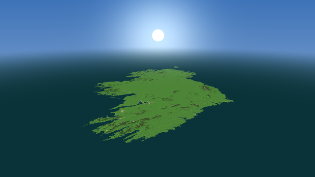 | **Terrain:** the first mesh from the Ireland heightmap, with per-vertex normals and one directional light. |
|  | **Materials:** grass, rock and sand blended by height and slope, seen from the south-east. |
|  | **Shadows:** cascaded and horizon-map shadows at golden hour over the procedural ridges. |
| 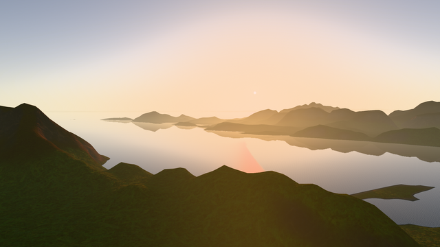 | **Water:** Gerstner waves, reflections and the sun's glint over Dingle Bay. |

</details>

## Credits

- Elevation: Copernicus DEM GLO-90. Contains modified Copernicus DEM data, © DLR e.V. 2010–2014 and © Airbus Defence and Space GmbH 2014–2018, provided under COPERNICUS by the European Union and ESA ([how it was built](tools/README.md)).
- Terrain textures: CC0 from [ambientCG](https://ambientcg.com/).
- Libraries: [GLFW](https://www.glfw.org/), [glad](https://github.com/Dav1dde/glad), [GLM](https://github.com/g-truc/glm), [stb](https://github.com/nothings/stb), [Dear ImGui](https://github.com/ocornut/imgui), [doctest](https://github.com/doctest/doctest), [Emscripten](https://emscripten.org/).
- Font: Roboto (Apache 2.0), shipped with Dear ImGui.

Every asset, with its source and licence, is listed in [CREDITS.md](CREDITS.md).

## License

[MIT](LICENSE)
