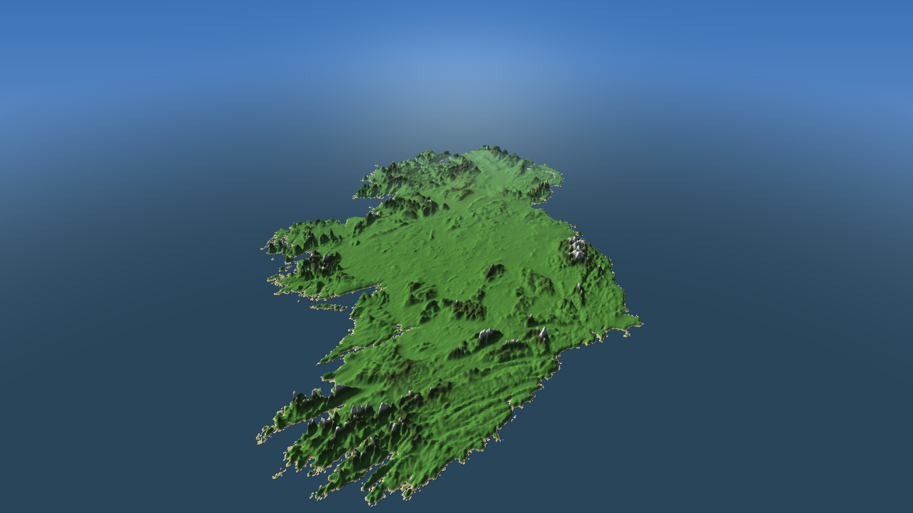

# Emerald Isle

[](https://github.com/leahweldon/emerald-isle/actions/workflows/build.yml)

A real-time terrain renderer of Ireland, written in C++17 and modern shader-based OpenGL.

> **Work in progress.** This is a ground-up rebuild of my Year 4 Computer Graphics final project at Trinity College Dublin, *Toward a Futuristic Emerald Isle*. The original used legacy fixed-function OpenGL; this version is built on a programmable pipeline, runs on macOS, Windows and Linux, and implements the features the original only approximated.



## Roadmap

- [x] **1. Foundations:** cross-platform build, OpenGL 3.3 core context, shader loading, FPS display, CI
- [x] **2. Terrain:** mesh generated from an Ireland heightmap, with per-vertex normals and directional lighting
- [ ] **3. Surface materials:** grass, rock and sand blended by height and slope
- [ ] **4. Sky and camera:** cubemap sky and a free-fly camera
- [ ] **5. Infinite world:** terrain chunks streamed around the camera, with level of detail
- [ ] **6. Shadows:** shadow mapping from a moving sun, with a day/night cycle
- [ ] **7. Water:** planar reflections and animated waves
- [ ] **8. Weather:** GPU-instanced rain
- [ ] **9. Tools:** in-app panel for toggling features and viewing frame timings
- [ ] **10. Web:** WebGL build with a live demo

## Building

Requirements: a C++17 compiler, CMake 3.20+ and Git. All libraries are downloaded automatically when you configure.

```bash
git clone https://github.com/leahweldon/emerald-isle.git
cd emerald-isle
cmake -S . -B build -DCMAKE_BUILD_TYPE=Release
cmake --build build --config Release
```

On Linux, install the X11 and OpenGL headers first:

```bash
sudo apt-get install libxrandr-dev libxinerama-dev libxcursor-dev libxi-dev libgl-dev
```

## Running

```bash
./build/emerald-isle                 # macOS / Linux
build\Release\emerald-isle.exe       # Windows (Visual Studio generator)
```

| Option | Description |
|---|---|
| `--width <px>`, `--height <px>` | Window size (default 1280 × 720) |
| `--no-vsync` | Render as fast as possible, to measure frame rate |
| `--frames <n>` | Exit after rendering *n* frames |
| `--screenshot <file>` | Save the final frame as a PNG, then exit |

The window title shows the averaged frame rate and frame time. Press **Esc** to quit.

## Project structure

```text
src/
  core/     window and context, frame timing, application loop, screenshots
  render/   shaders, camera, terrain mesh and render passes
assets/
  shaders/  GLSL source
  textures/ Ireland heightmap
external/
  glad/     OpenGL 3.3 core loader (generated with glad2)
```

## Built with

[GLFW](https://www.glfw.org/) · [glad](https://github.com/Dav1dde/glad) · [GLM](https://github.com/g-truc/glm) · [stb](https://github.com/nothings/stb)
